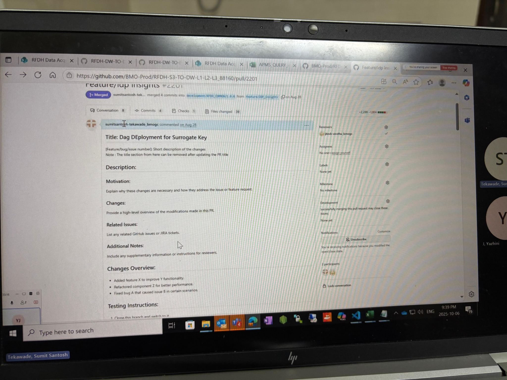
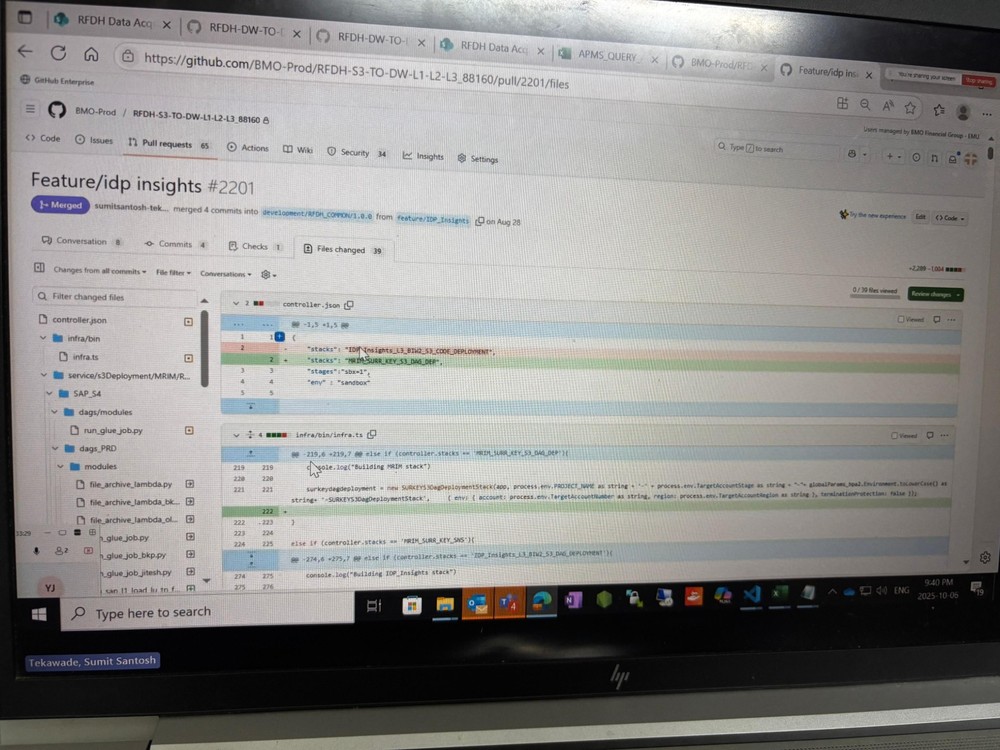
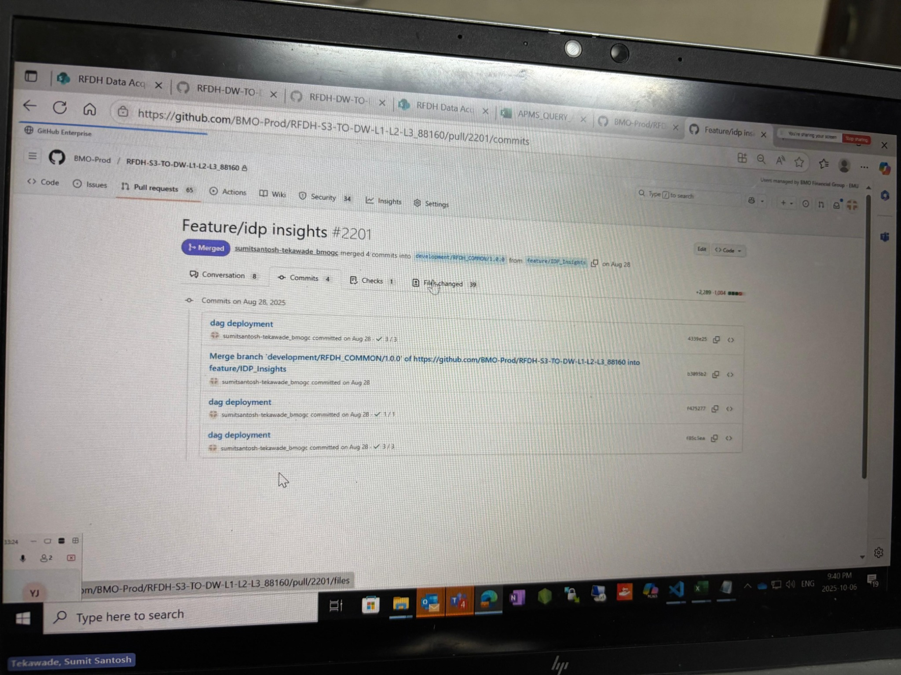
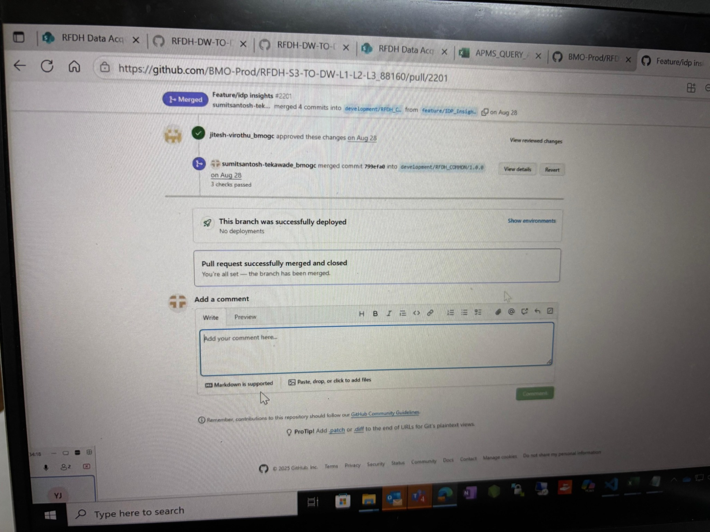
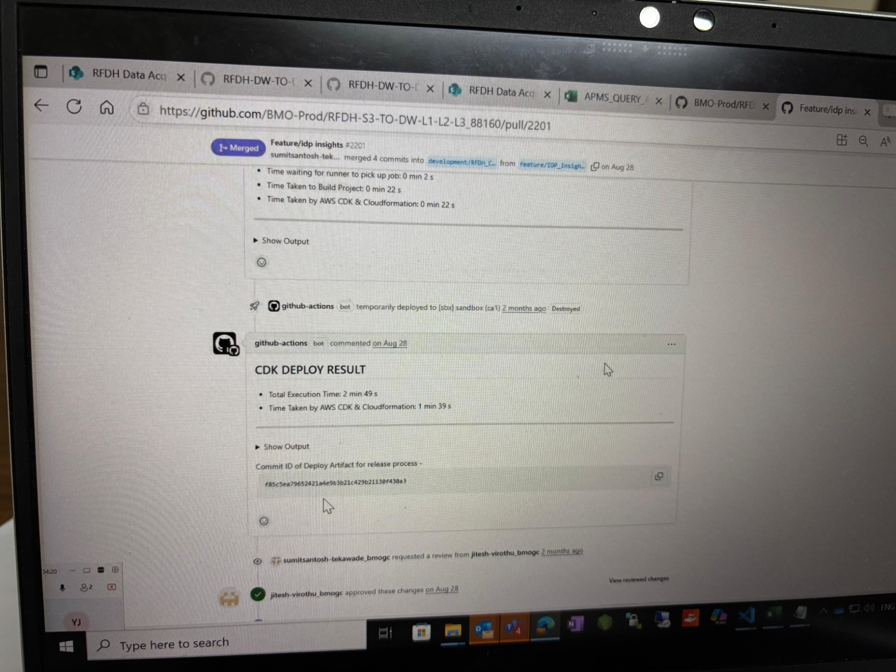
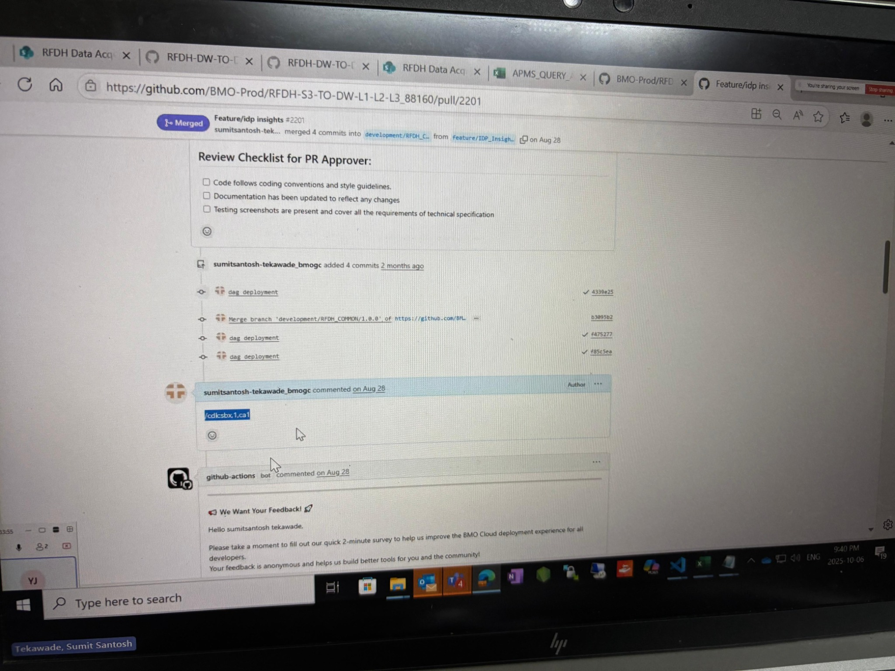
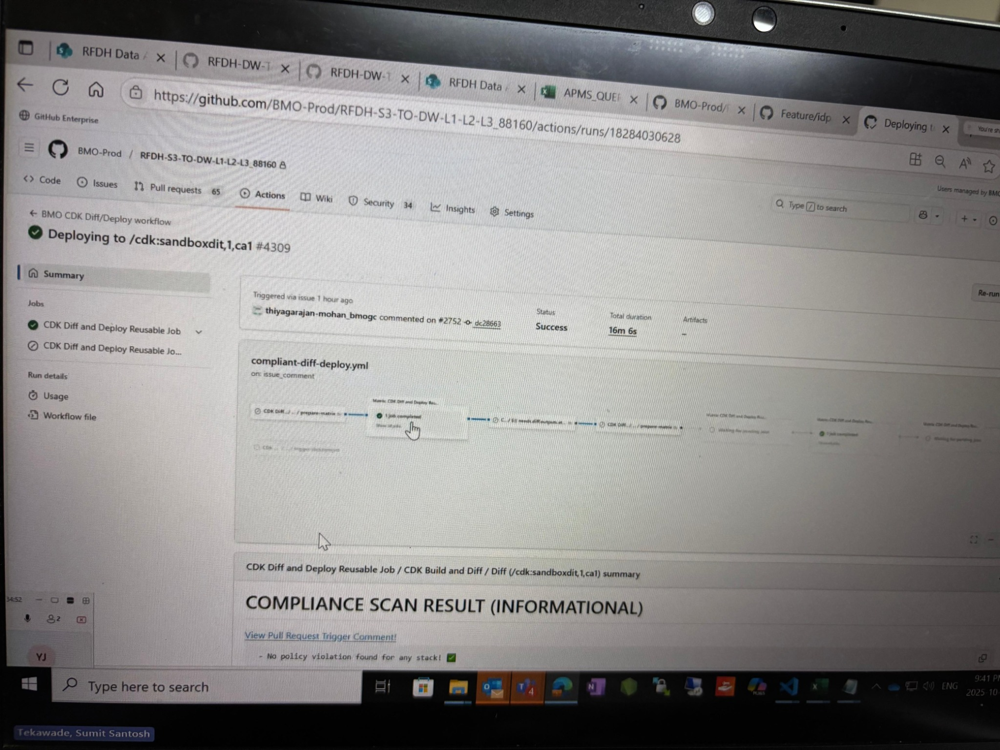
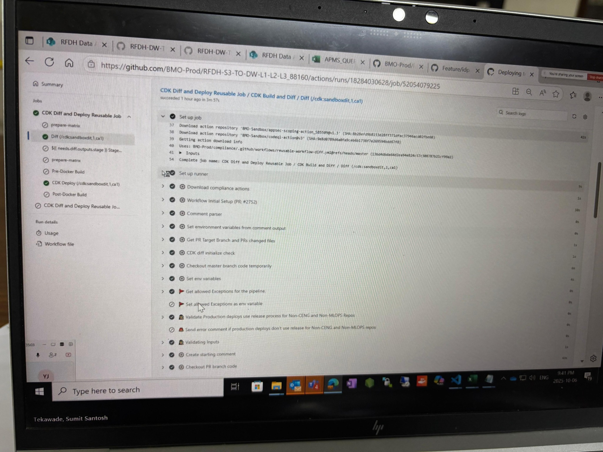
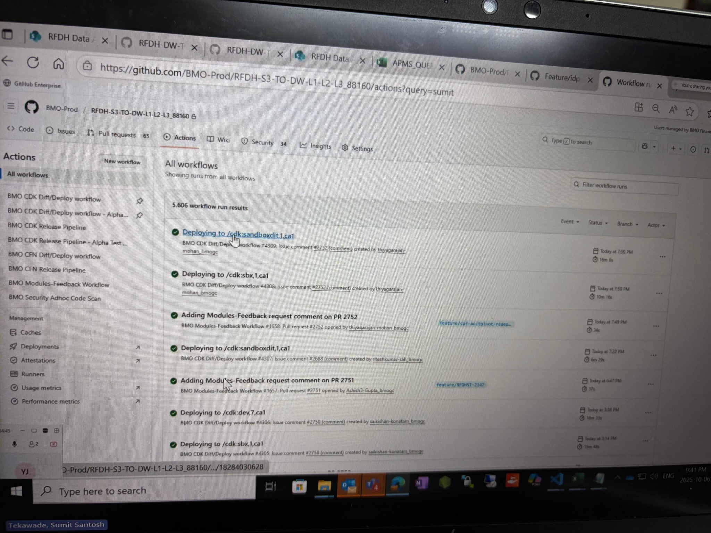
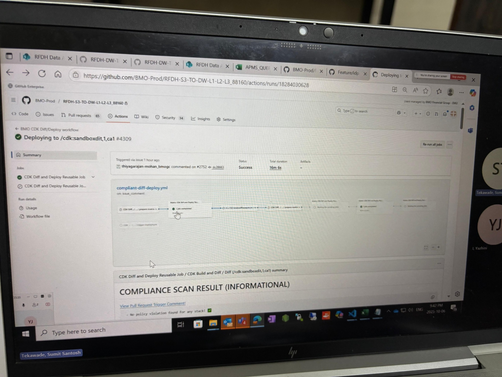

# Mini Project: VS Code + Git + CI (CDK-style demo)

A tiny, self-contained project that mirrors your screenshots: PR template, file diffs, CI workflow with diff/deploy steps, and a sandbox ‘deploy’ (demo).

## Quickstart

1. Open this folder in **VS Code**.

2. Install Python 3.10+.

3. Run the smoke test from VS Code (Terminal → Run Task → *Run smoke test*), or:

   ```bash
   python -m project.scripts.smoke_test
   ```

4. Initialize git and make a demo PR:

   ```bash
   git init
   git add -A
   git commit -m "initial"
   git branch -M development
   git remote add origin <your-empty-repo-url>
   git push -u origin development
   git checkout -b feature/idp_insights
   echo "demo change" >> demo.txt
   git add demo.txt
   git commit -m "dag deployment: demo change"
   git push -u origin feature/idp_insights
   ```

5. On GitHub, open a **Pull Request**. The PR template will appear and the **Actions** tab will show the demo workflow.


## Screenshots mapping

**Step 1**




**Step 2**




**Step 3**




**Step 4**




**Step 5**




**Step 6**




**Step 7**




**Step 8**




**Step 9**




**Step 10**




## What’s inside


- `.github/PULL_REQUEST_TEMPLATE.md` – matches your PR sections (Motivation/Changes/Testing)
- `.github/workflows/cdk-diff-deploy-demo.yml` – CI showing “Diff” and “Deploy” steps (safe demo)
- `controller.json`, `infra/bin/infra.ts` – placeholder files similar to your diffs
- `.vscode/` – ready-to-run tasks and debug
- `GIT_CMDS.md` – copy-paste Git flow
